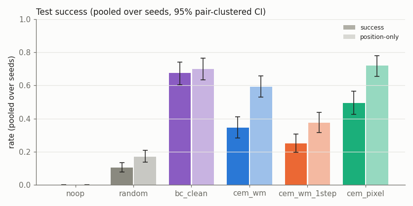
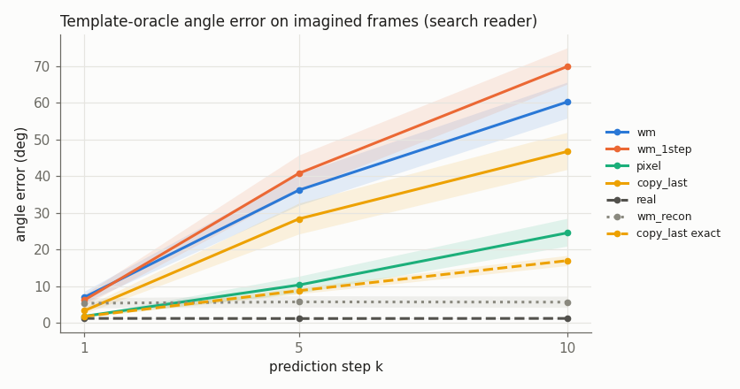
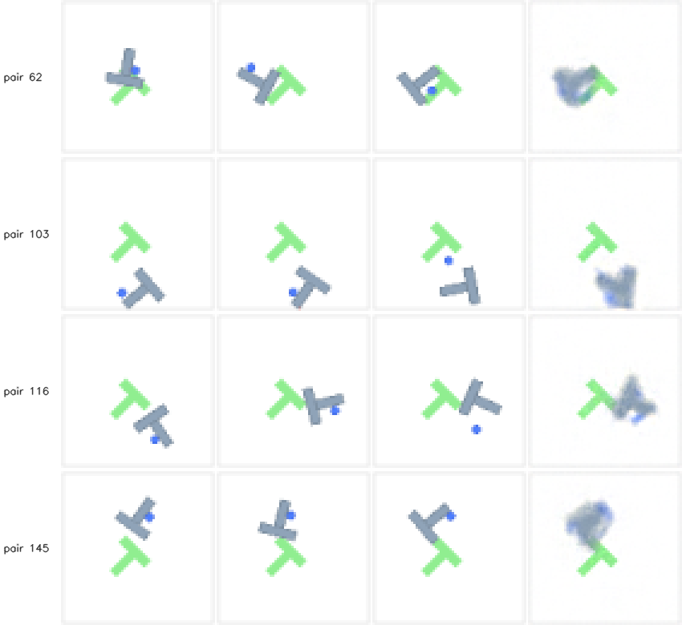

<!-- Generated by `python run.py --job make_report` from docs/README.template.md and the committed results JSONs. Edit the template, not this file. -->
# Latent world model + CEM planning on PushT, from pixels

An action-conditioned latent world model (CNN encoder, GRU dynamics, decoder; 4.2M parameters) trained on a 20,000-transition PushT dataset, used for goal-image reaching with CEM model-predictive control, and compared with a pixel-space predictor and goal-conditioned behaviour cloning. All test-set comparisons were pre-registered before they were run.

**TL;DR**
- **Multi-step training works:** training the dynamics on 10-step open-loop rollouts instead of teacher forcing gives 60.0% lower 10-step latent prediction error (95% CI 51.2 to 67.6%) and +9.5 pp planning success (+21.7 pp position-only) over 200 held-out goals × 3 seeds, both significant after Holm correction (exact McNemar, Holm p = 0.0327 and 2.99e-06).
- **Latent planning is fast but weaker than pixel planning:** latent CEM takes 0.022 s per planning call vs 0.437 s for pixel-space CEM (about 20× faster), at −14.8 pp success.
- **Behaviour cloning beats planning:** goal-conditioned BC reaches 67.5% success vs 34.7% for the latent planner.
- **Diagnosis:** imagined rollouts lose the block's orientation (pre-registered verdict: confirmed; 60.2° error at k = 10 vs 5.7° for plain reconstruction), and 92% of the planner's failures (361 of 392) are model errors: the planner believed it had reached the goal.


*Test success (dark) and position-only success (light) per method, averaged over planner seeds, with 95% pair-clustered bootstrap CIs.*


*Block-orientation error read by a non-learned template oracle on imagined frames: the world model's rollout (blue) loses the angle step by step, while decoding a real latent (grey, dotted) does not.*


*Latent-planner test episodes tagged "position only" (columns: start, goal, final frame, decoded imagined terminal frame of the last plan): the block ends at the right place with the wrong orientation, and the imagined frame is a blur; the green T is gym-pusht's fixed marker, not the evaluation goal.*

## 1. Task and data
**Environment.** `gym_pusht/PushT-v0` (gym-pusht): a round pusher pushes a T-shaped block on a table. Observations are 96×96 RGB renders, resized to 64×64; an action is an absolute target position for the pusher. The model never sees the true state; states are used only for data statistics, success checks and evaluation.

**Data.** A noisy scripted expert pushes the block towards a random sub-goal, redrawn every 25 steps. Each episode samples Gaussian action noise σ ∈ {5, 15, 30} px and a random-jump probability ε ∈ {0.05, 0.15}, so the data mixes clean pushes with clumsy ones. Every episode runs exactly 100 actions (never ended early) and stores 101 frames. Splits are by episode seed:

| split | episode seeds | episodes | transitions (actions) |
| --- | --- | --- | --- |
| train | 0–189 | 190 | 19,000 |
| validation | 190–199 | 10 | 1,000 |
| **train + val** | | **200** | **20,000** |
| test (separate file) | 1000–1029 | 30 | 3,000 |

The counts are checked against the training checkpoints: 16,910 train and 890 validation windows of thirteen frames, and 3,030 test frames. The world model, the pixel model and BC train on the train split only and select nothing on test. Two state probes used only as measuring instruments (section 3) also saw extra frames rendered from random states.

## 2. Method
### World model
| part | design |
| --- | --- |
| encoder E | four stride-two conv layers with SiLU, 64×64 → 4×4, then Linear → z ∈ R^256 and a non-affine LayerNorm |
| dynamics | φ = Linear([z, p, a]) + SiLU → GRUCell (hidden 320) → residual step ẑ' = LN(ẑ + Δ(h)); a head predicts the pusher position p̂' = p̂ + Δp(h) |
| decoder D | Linear → 4×4 feature map → four transposed convs → 64×64 image |

Parameters: encoder 1,738,976, dynamics 704,514, decoder 1,742,563, total **4,186,053**; the planner uses encoder + dynamics (2,443,490).

**Training** uses windows of 3 context frames and a 10-step future. The GRU warms up on the context, then rolls out **open loop**: each predicted ẑ is fed back as the next input. The loss is a weighted sum of
- frame reconstruction D(E(o)) for every frame (weight 1);
- latent prediction ‖ẑ − sg(E(o))‖² (weight 0.1);
- decoded-prediction error D(ẑ) vs the real future frames (weight 1);
- a **VICReg-style variance hinge** on the batch std of every latent dimension (weight 1), which stops representation collapse (section 5);
- pusher-position prediction (weight 1).

Reconstruction and image terms are **foreground-weighted** (pixels that differ from the mean training frame count 20× more), because the block and pusher cover only a few per cent of the image. Training: 30,000 steps, batch 64, AdamW with warm-up + cosine, fp16, about 39.3 minutes on a Kaggle T4.

**Baselines.**
- `wm_1step`: the same model trained with teacher forcing (the real E(o) is fed at every step); it differs from `wm` in nothing else.
- `pixel`: a U-Net (4,813,731 parameters) predicting the next frame from the last 3 frames and the action, rolled out autoregressively.
- `bc_clean`: goal-conditioned behaviour cloning (shared CNN encoder on 3 context frames + the goal frame, MLP head, 2,528,482 parameters) trained on the expert's clean actions. It was picked over BC on the noisy logged actions by validation success (32 vs 26 of 50), by a pre-registered rule.
- `random` (random waypoints) and `noop` (stay put).

### CEM model-predictive control
At every environment step the planner encodes the last 3 real frames, warms up the GRU, and searches over 10-step plans of pusher waypoints (per-step moves clipped to ±50 px). The cost uses only the image latent of the goal frame z_g:

cost = ‖ẑ_H − z_g‖² + β · Σ_{k<H} ‖ẑ_k − z_g‖²,  β = 0.1.

CEM: 128 candidates, 4 rounds, 12 elites, initial σ 30 px, warm start from the previous plan. Only the first waypoint is executed, then it replans. These settings were frozen after a validation sweep (section 5). `cem_wm_1step` uses the same planner with the teacher-forced model. `cem_pixel` uses the same planner and cost with the pixel U-Net as dynamics, its predicted frames encoded by E.

## 3. Evaluation protocol
- **Goal pairs.** A start state and the real frame 20 steps later in the same test episode, kept only if the block moves ≥ 30 px or turns ≥ 20° between them: 200 test pairs (180 turning, 20 not), 50 validation pairs.
- **Success:** block centre of gravity within 20 px **and** angle within 20° of the goal pose, checked after every step, budget 40 steps. **Position-only success:** the 20 px condition alone.
- **Seeds:** every method runs planner seeds 0, 1, 2; `cem_pixel` runs seed 0 only (compute; pre-registered).
- **Pre-registration.** Every test-set comparison, threshold, bin and verdict rule was written into `PROGRESS.md` and committed before the run that produced it. Only validation pairs were used for any choice. Nothing was tuned after the test run.
- **Primary tests (6):** `cem_wm` vs `bc_clean`, `cem_wm_1step` and `cem_pixel`, each on success and position-only success. Exact McNemar test on seed 0, Holm correction over the 6 p-values, claim only if Holm p < 0.05. The effect size is a paired bootstrap CI over pairs (10,000 resamples) of each method's per-pair success averaged over its seeds. Pooled rates use a pair-clustered bootstrap. Everything else is secondary.
- **Measuring the imagined angle.** Learned state probes failed as judges. The first CNN probe memorised orientation: mean angle error 13.4° on train frames but 84.8° on validation and 76.2° on test (an angle audit found no label bug: re-rendered stored states match the stored frames with a mean absolute difference of 0.00). A second probe trained on real, decoded and rendered frames still failed its pre-registered acceptance (real-frame angle 46.5° vs a 15° gate). So orientation is read by a **non-learned template oracle**: render the T at the true position every 5° and pick the best match, searching small shifts. On real test frames its mean error is 1.3°. Block position in latents is read by a small MLP on E(o) (real-frame floor 7.0 px).

## 4. Results (test set)
### Main table
| method | seeds | success, pooled [95% CI] | success seed 0 [Wilson] | position-only, pooled | turning pairs: success | non-turning pairs: success | median final pos px / angle ° | median final angle ° once position reached | imagined success (of them failed) | s / episode | s / planning call |
| --- | --- | --- | --- | --- | --- | --- | --- | --- | --- | --- | --- |
| noop | 3 | 0.0% [0.0, 0.0] | 0/200 [0.0, 1.9] | 0.0% [0.0, 0.0] | 0.0% [0.0, 0.0] (n 180) | 0.0% [0.0, 0.0] (n 20, low power) | 70.6 / 43.9 | n/a (n 0) | – | 0.15 | – |
| random | 3 | 10.5% [7.8, 13.3] | 24/200 [8.2, 17.2] | 17.2% [13.7, 20.8] | 8.7% [6.3, 11.3] (n 180) | 26.7% [15.0, 40.0] (n 20, low power) | 54.2 / 39.9 | 18.0 (n 103) | – | 0.14 | – |
| bc_clean | 3 | 67.5% [60.5, 74.0] | 135/200 [60.7, 73.6] | 70.0% [63.5, 76.5] | 72.8% [66.1, 79.4] (n 180) | 20.0% [5.0, 40.0] (n 20, low power) | 18.8 / 15.6 | 13.6 (n 420) | – | 0.15 | – |
| **cem_wm** | 3 | 34.7% [28.3, 41.0] | 67/200 [27.3, 40.3] | 59.3% [53.0, 65.7] | 34.8% [28.7, 41.3] (n 180) | 33.3% [13.3, 53.3] (n 20, low power) | 19.2 / 29.6 | 19.1 (n 356) | 565 (361 failed) | 0.75 | 0.022 |
| cem_wm_1step | 3 | 25.2% [19.8, 30.8] | 48/200 [18.6, 30.4] | 37.7% [31.7, 43.7] | 23.7% [18.1, 29.6] (n 180) | 38.3% [20.0, 56.7] (n 20, low power) | 31.3 / 30.7 | 17.4 (n 226) | 330 (242 failed) | 0.84 | 0.021 |
| cem_pixel | 1 | 49.5% [42.5, 56.5] | 99/200 [42.6, 56.4] | 72.0% [65.5, 78.0] | 47.2% [40.0, 54.4] (n 180) | 70.0% [50.0, 90.0] (n 20, low power) | 15.8 / 19.4 | 17.3 (n 144) | 197 (98 failed) | 10.20 | 0.437 |

τ is the imagined-success threshold (validation-calibrated, 21.22 for `wm`): a CEM episode "believed" it succeeded if the best plan's terminal cost fell below τ.

### Primary tests (pre-registered)
| comparison | metric | seed 0 rates | discordant (a only / b only) | McNemar p | Holm p | claim | paired bootstrap difference a − b |
| --- | --- | --- | --- | --- | --- | --- | --- |
| cem_wm vs bc_clean | success | 33.5% vs 67.5% | 15 / 83 | 1.4e-12 | 8.39e-12 | bc_clean better | -32.8 [-41.2, -24.5] pp (seeds 3 vs 3) |
| cem_wm vs cem_wm_1step | success | 33.5% vs 24.0% | 38 / 19 | 0.0163 | 0.0327 | cem_wm better | +9.5 [+2.3, +16.7] pp (seeds 3 vs 3) |
| cem_wm vs cem_pixel | success | 33.5% vs 49.5% | 11 / 43 | 1.4e-05 | 5.61e-05 | cem_pixel better | -14.8 [-21.2, -8.7] pp (seeds 3 vs 1) |
| cem_wm vs bc_clean | pos_success | 60.5% vs 70.0% | 34 / 53 | 0.053 | 0.053 | no claim (Holm p = 0.053) | -10.7 [-19.3, -2.0] pp (seeds 3 vs 3) |
| cem_wm vs cem_wm_1step | pos_success | 60.5% vs 37.0% | 68 / 21 | 5.99e-07 | 2.99e-06 | cem_wm better | +21.7 [+13.8, +29.3] pp (seeds 3 vs 3) |
| cem_wm vs cem_pixel | pos_success | 60.5% vs 72.0% | 13 / 36 | 0.0014 | 0.00421 | cem_pixel better | -12.7 [-18.8, -6.7] pp (seeds 3 vs 1) |

Five of the six tests support a claim:
- the multi-step model plans better than the teacher-forced one;
- BC and pixel-space CEM both beat latent CEM on success.

The sixth, `cem_wm` vs `bc_clean` on position-only success, gets **no claim**: Holm p = 0.053, even though its bootstrap CI (−19.3 to −2.0 pp) excludes zero. On position alone the gap to BC shrinks (−10.7 pp vs −32.8 pp on full success), while pixel-space CEM stays clearly ahead (−12.7 pp). So much of the gap to BC is orientation, not position.

### Multi-step prediction (500 test windows)
NMSE = mean squared latent error divided by the latent variance; for a like-for-like comparison every method's predicted frames are re-encoded by E (the headline row). Block position is read by the latent judge; the pusher error comes from the model's own p̂.

| method | NMSE k = 1 | NMSE k = 5 | NMSE k = 10 | block px k = 10 (latent judge) | pusher px k = 10 (p̂) |
| --- | --- | --- | --- | --- | --- |
| wm (E(D(ẑ)), headline) | 0.021 [0.017, 0.027] | 0.069 [0.056, 0.084] | 0.122 [0.098, 0.150] | 20.9 [19.8, 22.0] | – |
| wm (direct ẑ) | 0.009 [0.007, 0.011] | 0.071 [0.057, 0.086] | 0.127 [0.103, 0.154] | 20.9 [19.8, 22.0] | 2.4 [2.2, 2.5] |
| wm_1step | 0.025 [0.018, 0.032] | 0.139 [0.106, 0.175] | 0.305 [0.264, 0.355] | 32.6 [30.2, 35.0] | 11.0 [10.2, 11.8] |
| pixel U-Net | 0.002 [0.002, 0.003] | 0.040 [0.027, 0.058] | 0.084 [0.066, 0.104] | 17.5 [16.4, 18.6] | – |
| copy_last | 0.009 [0.007, 0.012] | 0.136 [0.105, 0.173] | 0.283 [0.240, 0.331] | 32.1 [30.1, 34.2] | 66.8 [64.2, 69.5] |
| real frames (floor) | – | – | – | 6.8 [6.4, 7.1] | – |

- **vs teacher forcing:** at k = 10 the multi-step model's NMSE is 60.0% lower than `wm_1step`'s (95% CI 51.2 to 67.6%). It tracks the pusher to 2.4 px vs 11.0 px (copy-last 66.8 px).
- **vs the pixel model (negative):** the pixel U-Net predicts better. The NMSE "reduction" vs pixel is −45.4% (CI −90.0 to −9.5%), i.e. `wm`'s error is higher, and the block-error difference `wm` − pixel is +3.4 px (CI +2.3 to +4.5).

### Imagined orientation (template oracle, search reader, 500 test windows)
| row | k = 1 | k = 5 | k = 10 |
| --- | --- | --- | --- |
| real | 1.3 [1.2, 1.4] | 1.2 [1.2, 1.3] | 1.3 [1.2, 1.3] |
| wm_recon | 5.4 [4.2, 6.9] | 5.8 [4.3, 7.4] | 5.7 [4.3, 7.3] |
| wm | 7.0 [5.6, 8.7] | 36.2 [32.1, 40.7] | 60.2 [55.8, 65.6] |
| wm_1step | 6.3 [4.9, 7.9] | 40.8 [36.1, 45.8] | 69.9 [65.1, 75.0] |
| pixel | 1.9 [1.7, 2.0] | 10.4 [8.2, 12.8] | 24.6 [21.0, 28.5] |
| copy_last | 3.4 [2.6, 4.4] | 28.4 [24.3, 32.7] | 46.7 [41.8, 51.9] |
| copy_last_exact | 1.8 [1.6, 2.1] | 8.8 [8.0, 9.7] | 17.0 [15.7, 18.4] |

Paired differences (degrees, `wm` minus the other row; positive = `wm` worse):

| difference (°) | k = 1 | k = 5 | k = 10 |
| --- | --- | --- | --- |
| wm minus copy last | +3.7 [+2.1, +5.4] | +7.8 [+2.5, +13.4] | +13.5 [+6.9, +20.5] |
| wm minus wm 1step | +0.8 [−1.1, +2.7] | −4.6 [−10.0, +0.4] | −9.6 [−16.0, −3.1] |
| wm minus pixel | +5.2 [+3.8, +6.8] | +25.8 [+21.5, +30.4] | +35.7 [+30.4, +41.4] |
| wm minus wm recon | +1.6 [−0.0, +3.4] | +30.5 [+26.2, +35.3] | +54.5 [+49.6, +59.8] |
| wm minus copy last exact | +5.2 [+3.8, +6.8] | +27.4 [+23.4, +31.8] | +43.2 [+38.7, +48.6] |

**Verdict (pre-registered, k = 10): "imagined rollouts lose the angle" = confirmed.** Both conditions hold:
- (A) the rollout adds error beyond reconstruction (+54.5°, CI +49.6 to +59.8);
- (B) it is worse than simply copying the last frame, both as read by the oracle (+13.5°) and against the true angle change (+43.2°).

Multi-step training helps a little (`wm` − `wm_1step` = −9.6°, CI −16.0 to −3.1). The pixel model keeps the angle far better (24.6°).

### Speed
| method | s / episode (mean) | s / full-size planning call |
| --- | --- | --- |
| noop | 0.15 | – |
| random | 0.14 | – |
| bc_clean | 0.15 | – |
| cem_wm | 0.75 | 0.022 |
| cem_wm_1step | 0.84 | 0.021 |
| cem_pixel | 10.20 | 0.437 |

### Failure tags (from the final state; all seeds, seed 0 in brackets)
| method | success: all seeds (seed 0) | position_only: all seeds (seed 0) | angle_only: all seeds (seed 0) | both_failed: all seeds (seed 0) | believed success but failed |
| --- | --- | --- | --- | --- | --- |
| noop | 0 (0) | 0 (0) | 60 (20) | 540 (180) | – |
| random | 63 (24) | 18 (3) | 56 (20) | 463 (153) | – |
| bc_clean | 405 (135) | 6 (2) | 69 (23) | 120 (40) | – |
| cem_wm | 208 (67) | 116 (43) | 39 (13) | 237 (77) | 361 |
| cem_wm_1step | 151 (48) | 42 (13) | 73 (22) | 334 (117) | 242 |
| cem_pixel | 99 (99) | 38 (38) | 5 (5) | 58 (58) | 98 |

`cem_wm` ends "position only" more often than any other method (116 episodes vs 6 for `bc_clean`). Of its 392 failures, 361 were believed successes: the bottleneck is mostly the model, not the search.

### Exploratory: goal difficulty and goal distance (no multiple-comparison correction; not claims)
Success / position-only per bin of block movement (px) and absolute turn (°), pooled over seeds:

| method | [0, 45) (n 43) | [45, 70) (n 56) | [70, 95) (n 47) | >= 95 (n 54) |
| --- | --- | --- | --- | --- |
| noop | 0.0% [0.0, 0.0] / 0.0% [0.0, 0.0] | 0.0% [0.0, 0.0] / 0.0% [0.0, 0.0] | 0.0% [0.0, 0.0] / 0.0% [0.0, 0.0] | 0.0% [0.0, 0.0] / 0.0% [0.0, 0.0] |
| random | 27.9% [20.2, 35.7] / 38.8% [30.2, 47.3] | 13.7% [8.9, 19.0] / 25.0% [17.9, 32.7] | 2.8% [0.7, 5.7] / 7.1% [3.5, 11.3] | 0.0% [0.0, 0.0] / 0.6% [0.0, 1.9] |
| bc_clean | 65.1% [51.2, 79.1] / 67.4% [53.5, 81.4] | 60.7% [48.2, 73.2] / 64.3% [51.8, 76.8] | 78.7% [66.0, 89.4] / 78.7% [66.0, 89.4] | 66.7% [53.7, 79.6] / 70.4% [57.4, 81.5] |
| cem_wm | 62.8% [48.8, 76.0] / 86.8% [76.7, 95.3] | 45.2% [33.3, 57.1] / 69.6% [58.9, 80.4] | 21.3% [10.6, 32.6] / 48.9% [36.2, 62.4] | 13.0% [5.6, 21.0] / 35.8% [24.1, 47.5] |
| cem_wm_1step | 37.2% [23.3, 51.9] / 51.2% [37.2, 65.1] | 25.0% [15.5, 35.1] / 37.5% [26.8, 49.4] | 18.4% [9.9, 28.4] / 34.8% [22.7, 46.8] | 21.6% [12.3, 32.1] / 29.6% [19.1, 41.4] |
| cem_pixel | 83.7% [72.1, 93.0] / 90.7% [81.4, 97.7] | 57.1% [44.6, 69.6] / 85.7% [76.8, 94.6] | 34.0% [21.3, 48.9] / 72.3% [59.6, 85.1] | 27.8% [16.7, 40.7] / 42.6% [29.6, 55.6] |

| method | [0, 20) (n 20) | [20, 40) (n 74) | [40, 60) (n 46) | [60, 180] (n 60) |
| --- | --- | --- | --- | --- |
| noop | 0.0% [0.0, 0.0] / 0.0% [0.0, 0.0] | 0.0% [0.0, 0.0] / 0.0% [0.0, 0.0] | 0.0% [0.0, 0.0] / 0.0% [0.0, 0.0] | 0.0% [0.0, 0.0] / 0.0% [0.0, 0.0] |
| random | 26.7% [15.0, 40.0] / 31.7% [20.0, 45.0] | 18.5% [13.5, 23.9] / 27.9% [21.6, 34.2] | 4.3% [1.4, 8.0] / 13.8% [7.2, 21.0] | 0.0% [0.0, 0.0] / 1.7% [0.0, 3.9] |
| bc_clean | 20.0% [5.0, 40.0] / 25.0% [5.0, 45.0] | 73.0% [62.2, 82.4] / 74.3% [63.5, 83.8] | 69.6% [56.5, 82.6] / 73.9% [60.9, 87.0] | 75.0% [63.3, 85.0] / 76.7% [65.0, 86.7] |
| cem_wm | 33.3% [13.3, 53.3] / 63.3% [41.7, 83.3] | 48.6% [38.3, 59.5] / 66.7% [56.3, 76.6] | 39.9% [27.5, 52.9] / 61.6% [48.6, 73.9] | 13.9% [6.7, 22.2] / 47.2% [35.6, 58.9] |
| cem_wm_1step | 38.3% [20.0, 56.7] / 43.3% [23.3, 63.3] | 31.1% [22.1, 41.0] / 41.9% [32.0, 51.8] | 24.6% [13.8, 36.2] / 45.7% [33.3, 58.0] | 13.9% [6.1, 22.2] / 24.4% [14.4, 35.0] |
| cem_pixel | 70.0% [50.0, 90.0] / 85.0% [70.0, 100.0] | 70.3% [59.5, 79.7] / 83.8% [74.3, 91.9] | 47.8% [34.8, 60.9] / 78.3% [65.2, 89.1] | 18.3% [8.3, 28.3] / 48.3% [35.0, 61.7] |

Goal-distance sweep (seed 0; goal 10 or 30 steps ahead instead of 20):

| goal offset | pairs | candidates | median move px | median |turn| ° | cem_wm: success / position-only (seed 0) | bc_clean: success / position-only (seed 0) |
| --- | --- | --- | --- | --- | --- | --- |
| 10 | 100 | 228 | 48.2 | 28.2 | 64/100 [54.2, 72.7] / 85/100 [76.7, 90.7] | 83/100 [74.5, 89.1] / 84/100 [75.6, 89.9] |
| 30 | 100 | 380 | 93.0 | 56.0 | 20/100 [13.3, 28.9] / 56/100 [46.2, 65.3] | 51/100 [41.3, 60.6] / 52/100 [42.3, 61.5] |

The pattern: latent CEM is competitive on short moves and degrades with distance, while BC stays roughly flat.
- Moves in [0, 45) px: `cem_wm` 62.8% vs `bc_clean` 65.1%.
- Moves >= 95 px: `cem_wm` 13.0% vs `bc_clean` 66.7%.
- Goal-distance sweep, `cem_wm` vs `bc_clean` successes (of 100 pairs each): 64 vs 83 at 10 steps ahead; 20 vs 51 at 30 steps.

## 5. What went wrong, and what I learned
- **Representation collapse.** The model as first specified collapsed: every frame encoded to nearly the same latent (z std 0.0036). The prediction losses were then trivially small. A local comparison of five fixes (400 CPU steps each, `results/ablation_collapse_local.json`) picked a VICReg-style variance hinge (z std 0.8232). Lesson: a latent-prediction loss alone has a collapsed optimum; watch z std from step one.
- **The first latent did not contain the pusher.** A ridge probe on the first model's latents missed the pusher by 79.3 px. The pusher is a small blob, and a plain pixel loss barely notices it. A pre-registered ablation (5,000 steps per variant) adopted foreground weighting + an explicit pusher state, giving p̂ errors of 2.2 px at k = 10 vs 60.2 px for copy-last. A third option, keeping the checkpoint with the best validation NMSE, was rejected: those weights were physically worse.
- **The judge memorised.** The first evaluation probe looked fine on training frames and was confidently wrong on held-out ones (section 3). The audit ruled out a label bug. The fix was to stop trusting learned judges for orientation and use a non-learned template oracle. Lesson: validate the instrument on held-out and out-of-distribution frames before reading any model through it.
- **A sharper planning cost did not help.** On validation the planner reached the position but not the angle (`cem_wm` 13 successes but 32 position-only of 50, and 33 of 45 believed successes failed for real). A pre-registered diagnostic replaced the latent cost with a foreground-weighted pixel cost on decoded frames. Result: 13 vs 13 successes, a null (it needed 3 more to join the final test), at 8.41 s per episode. The CEM sweep also changed nothing: best variant 14 vs default 13 successes.
- **The angle is lost in the rollout.** The null above pointed away from the cost and toward the prediction. The test-set oracle confirmed it:
  - orientation survives encoding and decoding (5.7°) but not imagination (7.0° → 36.2° → 60.2° at k = 1, k = 5, k = 10);
  - a latent judge also rates orientation in real latents as only "weak" (24.7° error).
  - Lesson: a planner can only optimise what its model imagines; check what the rollout keeps before tuning the search.

## 6. Deviations from the pre-registration (disclosed)
From `PROGRESS.md`, one line each:
- **Judge freeze after the rollout evaluation:** the pre-registered rule allowed a block-position headline only with an accepted image judge. None was accepted, and I then chose the latent MLP judge as primary for block position, with the image probe as a sign check only. This was decided after seeing results.
- **Orientation reader:** after the same results, only the non-learned template oracle is trusted for angle. Learned-judge angle columns stay in `results/rollouts.json` but are not used.
- **Imagined-success threshold for `cem_wm_1step` on validation:** the validation run compared `cem_wm_1step`'s costs (its own encoder space) with `wm`'s τ. The final evaluation uses each encoder's own τ, so the validation imagined counts for `cem_wm_1step` are not comparable.
- **Movement-bin wording:** the first movement bin is written [0, 45). All 200 test pairs start at least 20 px away, so it is effectively [20, 45).
- **Bin CIs:** the first plan draft said Wilson intervals; the committed pre-registration and the results use the pair-clustered bootstrap over seeds (as the pooled rates do) with seed-0 Wilson counts alongside, because Wilson intervals on pooled seeds would overstate precision.
- **Spec changes made during the build, each before the results it affects:**
  - the variance hinge;
  - foreground weighting + pusher state (chosen by the pre-registered ablation);
  - block position measured at the T's centre of gravity;
  - the final frame stored per episode;
  - a widened parameter-count tolerance for the pixel U-Net;
  - the checkpoint round-trip check relaxed from exact to `allclose` (CUDA transposed convolutions are not bit-reproducible).

## 7. Limitations and future work
Limitations of what was done:
- `cem_pixel` ran one planner seed. Its comparisons use seed 0 against the other methods' 3 seeds.
- The non-turning group has 20 pairs, too few to interpret.
- One dataset, one training seed per model, 64×64 frames.
- The bins and the goal-distance sweep are exploratory.

**Not done (ideas only, no results):**
- an orientation-aware objective (e.g. an angle head or an oriented-edge loss on the block) so the latent keeps the angle;
- higher image resolution, where the T's orientation spans more pixels;
- stronger dynamics (stochastic latents, attention over longer context) to slow the drift;
- shorter planning horizons with more frequent replanning, or a cost that switches to BC near the goal;
- extra training seeds for `wm` and BC.

## 8. Reproduce
**Local (Mac, CPU, smoke only):**
```bash
uv venv --python 3.11 && uv pip install -e ".[local,dev]"
.venv/bin/python -m pytest -q
.venv/bin/python run.py --job env_check --mode smoke
```
Locally every job runs in smoke mode; `--mode full` is refused (except `make_report`).

**Kaggle (T4) via `notebooks/runner.ipynb`, three cells:**
- cell one clones or pulls the repo and installs it (`pip install -e .`, keeping Kaggle's CUDA torch);
- cell two holds `JOB`, `MODE` and `EXTRA`, the only things you edit;
- cell three runs `python run.py --job {JOB} --mode {MODE} {EXTRA}`.

Add `WANDB_API_KEY` as a Kaggle secret: artifacts (data, checkpoints, results) live in W&B project `pusht-world-model`, so a later job, or a killed and restarted one, picks them up. Run each job in **smoke** mode first, in an interactive draft session (minutes; prints projected times). Then run **full** with *Save Version → Save & Run All*, so it keeps running after the browser closes. Finished jobs with the same config are skipped; training resumes from its last checkpoint.

Order: `env_check` → `collect_data` → `wm_ablate` (chose the recipe) → `overnight` (`train_wm`, `diagnose_wm`, baselines) → `phase5b` (angle audit, judges, `eval_rollouts`) → `phase6` (`make_pairs`, `train_bc_clean`, `plan_val`, `plan_sweep`) → `plan_cost_ablation` → `phase7` (`eval_imagined_angle`, `final_eval`) → `make_report` (locally, writes this README). Run times on a T4, from each results file's `wall_clock_s`:

| job | T4 minutes | source |
| --- | --- | --- |
| `train_wm` | 39.3 | `results/rollouts.json: checkpoints.wm.summary.wall_clock_s` |
| `train_wm_1step` | 40.4 | `results/rollouts.json: checkpoints.wm_1step.summary.wall_clock_s` |
| `train_pixel` | 7.3 | `results/rollouts.json: checkpoints.pixel.summary.wall_clock_s` |
| `train_bc` | 12.1 | `results/plan_val.json: checkpoints.bc.summary.wall_clock_s` |
| `train_bc_clean` | 11.5 | `results/plan_val.json: checkpoints.bc_clean.summary.wall_clock_s` |
| `train_probe` | 1.2 | `results/angle_audit.json: checkpoints.probe.summary.wall_clock_s` |
| `wm_ablate` | 21.5 | `results/ablation_wm_fixes.json: wall_clock_s` |
| `angle_audit` | 3.5 | `results/angle_audit.json: wall_clock_s` |
| `train_probe_mix` | 26.2 | `results/rollouts.json: checkpoints.probe_mix.summary.wall_clock_s` |
| `train_latent_probe` | 0.5 | `results/rollouts.json: checkpoints.latent.summary.wall_clock_s` |
| `eval_rollouts` | 0.7 | `results/rollouts.json: wall_clock_s` |
| `plan_val` | 11.9 | `results/plan_val.json: wall_clock_s` |
| `plan_sweep` | 5.8 | `results/plan_sweep.json: wall_clock_s` |
| `plan_cost_ablation` | 8.1 | `results/plan_cost_ablation.json: wall_clock_s` |
| `eval_imagined_angle` | 8.6 | `results/final/imagined_angle.json: wall_clock_s` |
| `final_eval` | 57.5 | `results/final/final_eval.json: wall_clock_s` |
| `env_check` | not recorded | no results JSON |
| `collect_data` | not recorded | no results JSON |
| `diagnose_wm` | not recorded | no results JSON |
| `render_judge_data` | not recorded | no results JSON |
| `make_pairs` | not recorded | no results JSON |

W&B artifacts: `pusht-data`, `judge-data`, `eval-pairs`, `ckpt-wm`, `ckpt-wm-1step`, `ckpt-pixel`, `ckpt-bc`, `ckpt-bc-clean`, `ckpt-probe`, `ckpt-probe-mix`, `ckpt-latent-probe`, and one `results-*` artifact per evaluation job.

## 9. Repository layout
```
run.py               the only entry point: python run.py --job <name> --mode smoke|full
jobs.yaml            job registry (needs / makes / groups)
configs/             one YAML per job; plan.yaml holds the frozen CEM settings
wm/envs/             gym-pusht wrapper: 64x64 render, state, reset_to_state, success
wm/data/             scripted expert, data collection, GPU window samplers, judge frames
wm/models/           encoder, dynamics, decoder, world model, pixel U-Net, BC, probes
wm/train/            the shared training loop (AMP, checkpoints, resume)
wm/planning/         batched CEM and the closed-loop MPC runner
wm/eval/             rollouts, planning metrics, statistics, template oracle, README rendering
wm/jobs/             one module per job
results/             committed results JSONs; results/final/ = the test evaluation
docs/                README template and the number-source list
scripts/             README / summary regeneration and one-off diagnostics
notebooks/           the three-cell Kaggle/Colab runner
tests/               CPU tests (pytest)
```
This README is generated: `docs/README.template.md` holds the text and `python run.py --job make_report` fills in every number from `results/`. `docs/readme_sources.md` lists each number with the file and key it came from.

## References
- gym-pusht: Hugging Face, `gym-pusht` PushT environment, https://github.com/huggingface/gym-pusht.
- C. Chi, S. Feng, Y. Du, Z. Xu, E. Cousineau, B. Burchfiel, S. Song. *Diffusion Policy: Visuomotor Policy Learning via Action Diffusion.* RSS 2023 (introduced the PushT task).
- R. Y. Rubinstein. *The Cross-Entropy Method for Combinatorial and Continuous Optimization.* Methodology and Computing in Applied Probability 1(2), 1999.
- D. Hafner, T. Lillicrap, I. Fischer, R. Villegas, D. Ha, H. Lee, J. Davidson. *Learning Latent Dynamics for Planning from Pixels* (PlaNet). ICML 2019 (CEM-MPC in a learned latent space).
- A. Bardes, J. Ponce, Y. LeCun. *VICReg: Variance-Invariance-Covariance Regularization for Self-Supervised Learning.* ICLR 2022 (the variance term).
- K. Cho et al. *Learning Phrase Representations using RNN Encoder–Decoder for Statistical Machine Translation.* EMNLP 2014 (GRU).
- O. Ronneberger, P. Fischer, T. Brox. *U-Net: Convolutional Networks for Biomedical Image Segmentation.* MICCAI 2015.
- Q. McNemar. *Note on the sampling error of the difference between correlated proportions or percentages.* Psychometrika 12(2), 1947.
- S. Holm. *A Simple Sequentially Rejective Multiple Test Procedure.* Scandinavian Journal of Statistics 6(2), 1979.
- E. B. Wilson. *Probable Inference, the Law of Succession, and Statistical Inference.* Journal of the American Statistical Association 22(158), 1927.
